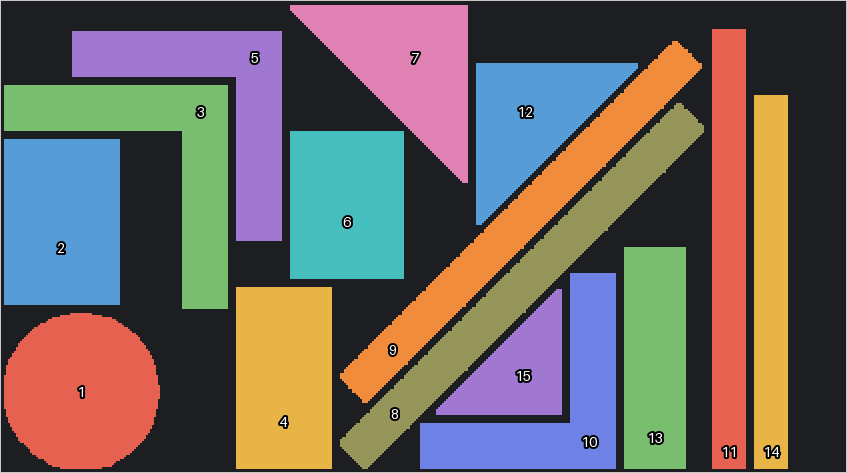
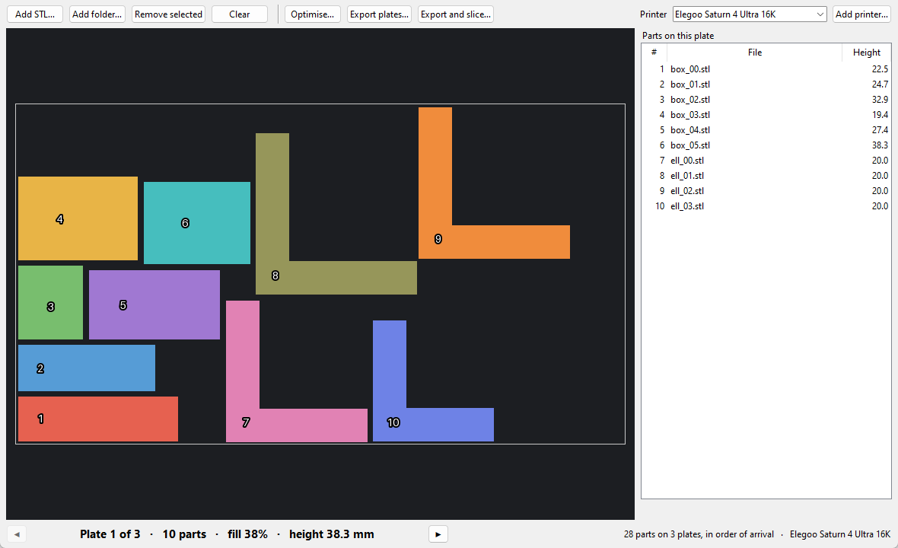

# nemnest

Auto-nesting of **pre-supported STLs** onto as few resin printer build plates as possible.

Point it at a folder of supported models and it gives you back one merged STL per plate, a preview image of each plate, and (optionally) ready-to-print sliced files. It works from the command line and as an [MCP](https://modelcontextprotocol.io) server, so an AI assistant such as Claude can run the whole job for you.



## What it does

- **Nests on the real footprint**, not on bounding boxes, so parts interlock.
- **Rotates around Z only**, so the supports that came with the model stay valid.
- **Lets rafts overlap.** Geometry in the first millimetre counts as raft: rafts may overlap each other and slide under other parts, model bodies keep their distance.
- **Optionally minimises print time**: with the same number of plates, tall parts are grouped together so short plates finish early.
- **Attaches small rafts** to larger ones where possible, so tiny parts come off the plate in one piece with their neighbours.
- **Slices** the plates with [mslicer](https://github.com/connorslade/mslicer) and fixes the `.goo` metadata (exposure schedule, print time, resin volume and weight).
- Uses the GPU for the placement search when CuPy and an NVIDIA card are available; otherwise runs on the CPU.

## Status and a word of caution

This is young software. The placement is checked by automated tests on the real geometry, and the full chain (placement, slicing, printing) has been verified on real prints with **one printer: the Elegoo Saturn 4 Ultra 16K**. Profiles for 36 other popular printers are included for arranging only: slicing for them is not verified.

A wrong print file can ruin a print or damage a vat film. Before the first print on your machine, **open the sliced file in your usual slicer and check the first layers and the settings**. You use this software at your own risk (see the licence).

## Download for Windows

No Python needed: download `nemnest-...-windows.zip` from the [latest release](https://github.com/nemwiper/nemnest/releases/latest), unzip it anywhere and run `nemnest.exe`. It opens [the window](#window), with drag and drop.

- The program is not code-signed, so the first time Windows shows "Windows protected your PC": choose *More info*, then *Run anyway*.
- It runs on the CPU. For GPU acceleration, the command line or the MCP server, install with Python as below.
- To slice from the window, put mslicer's `slicer.exe` (see [Slicing](#slicing-optional)) in the same folder as `nemnest.exe`.

## Download for macOS

No Python needed: from the [latest release](https://github.com/nemwiper/nemnest/releases/latest) download `nemnest-...-macos-arm64.zip` for a Mac with Apple Silicon (M1 and later) or `nemnest-...-macos-intel.zip` for an Intel Mac. Unzip it and move `nemnest.app` to Applications. It opens [the window](#window), with drag and drop.

- The app is not signed by an Apple developer yet, so the first time macOS refuses to open it ("Apple could not verify nemnest is free of malware"). Click *Done*, then open *System Settings → Privacy & Security*, scroll down to the message about nemnest and click *Open Anyway*. From then on it opens normally.
- Or, from Terminal: `xattr -dr com.apple.quarantine /Applications/nemnest.app`
- It runs on the CPU. For the command line or the MCP server, install with Python as below.
- To slice from the window, build mslicer's `slicer` (see [Slicing](#slicing-optional)) and put it in the same folder as `nemnest.app`.

## Updates

When the window opens, the Windows and macOS programs ask GitHub whether there is a newer release (one request to the GitHub API, which sees your IP address and nemnest version like any website would; no files or settings are sent). If there is, a bar above the plate offers *Update and restart*: nemnest downloads the package for your computer, checks it, closes, swaps its files and opens the new version. Your settings, printer profiles and a `slicer` next to the program are kept.

An update is installed only if the release is signed with the maintainer's key, which is kept offline and not on GitHub: a package that does not match its signed hash is refused. Turn the check off with `nemnest config --check-updates off` (or `"check_updates": false` in the config file). A Python install is shown the `pip` command instead.

## Install

Python 3.10 or newer.

```bash
pip install git+https://github.com/nemwiper/nemnest
```

GPU acceleration (optional, NVIDIA with CUDA 12):

```bash
pip install cupy-cuda12x
```

### Slicing (optional)

Arranging plates needs nothing else. To also slice them, nemnest drives the mslicer command-line slicer, which is a separate program under its own licence (GPL-3.0) and is not bundled. Build it with [Rust](https://rustup.rs):

```bash
git clone --depth 1 --branch v0.10.1 https://github.com/connorslade/mslicer
```

```bash
cd mslicer && cargo build --release --package slicer --bin slicer
```

Then tell nemnest where the binary is (`target/release/slicer`, or `slicer.exe` on Windows):

```bash
nemnest config --slicer /path/to/mslicer/target/release/slicer
```

nemnest was developed against mslicer v0.10.1.

## Window

```bash
nemnest gui
```



A simple top view, one plate per screen, no 3D. Import STL files or a whole folder, with the buttons or by dragging them onto the window: parts are placed as they arrive, unrotated, and a new plate is opened when one no longer fits. Adding parts never moves the ones already placed.

- Move between plates with the mouse wheel, the arrow keys or Page Up / Page Down.
- After each import a short summary tells you how many parts were added and how many plates there are.
- **Optimise** rearranges everything on as few plates as possible (rotation, height grouping and the minimum gap between parts are options; the gap, 0 to 20 mm, is remembered for next time, also by the command line and the MCP server), with a progress bar, the best result so far and a Cancel button that keeps the current layout.
- **Export plates** writes the merged plate STLs, previews and `layout.json`; **Export and slice** also produces the print files.
- Pick the printer from the list, or **Add printer** to enter the plate size of your own.

Drag and drop needs one small extra package: `pip install "nemnest[gui] @ git+https://github.com/nemwiper/nemnest"`, or just `pip install tkinterdnd2`. Without it the window works the same, with the buttons only.

The window uses Tkinter, which comes with Python on Windows and macOS. On Debian/Ubuntu: `sudo apt install python3-tk python3-pil.imagetk`.

## Command line

```bash
nemnest scan ./my_model/supported
```

```bash
nemnest arrange ./my_model/supported -o ./plates --optimize-height
```

```bash
nemnest slice ./plates --exposure 2.5 --first-exposure 30
```

`arrange` writes `plate_01.stl`, `plate_01.png`, ... and `layout.json` to the output folder. Existing `plate_NN.*` files there are replaced.

Useful options of `arrange`:

| Option | Meaning |
|---|---|
| `-x "*water*"` | leave out files matching a pattern (repeatable) |
| `--no-stl` | placement only: previews and `layout.json`, quick to review |
| `--optimize-height` | group tall parts to cut total print time, never adding plates |
| `--no-center` | leave the parts packed into one corner; by default each plate's group is moved to the middle of the plate |
| `--gap 2` | minimum distance between parts, mm (0 to 20); `nemnest config --gap 1.5` changes the default |
| `--edge 1` | minimum distance from the plate edge, mm |
| `--raft-height 1` | thickness treated as raft; `0` turns raft overlap off |
| `--rotation-step 45` | Z rotation step in degrees; `0` keeps the original orientation |
| `--copies orc.stl=3` | print several copies of a file |
| `--attempts 40 --time-limit 200` | search longer for a better result |
| `--cpu` / `--gpu` | force the backend |

After reviewing a `--no-stl` layout, `nemnest export ./plates` writes the plate STLs without redoing the search. `printers`, `scan`, `arrange`, `export` and `slice` accept `--json` for machine-readable output, and `nemnest <command> --help` lists everything.

Exposure settings come from the printer profile and are only a starting point: **use the values for your resin**.

## With an AI assistant (MCP)

`nemnest mcp` runs an MCP server on stdin/stdout with the tools `list_printers`, `scan_folder`, `arrange_plates`, `export_plates` and `slice_plates`.

Claude Code:

```bash
claude mcp add nemnest -- nemnest mcp
```

Claude Desktop and other clients, in the MCP servers configuration:

```json
{
  "mcpServers": {
    "nemnest": { "command": "nemnest", "args": ["mcp"] }
  }
}
```

Then ask in plain words, for example: *"Arrange the STLs in this folder on as few plates as possible, leave out the water effects, and show me the previews before slicing."* Placement of many large models can take a few minutes, so raise the client's tool timeout if it is short.

## Printers

```bash
nemnest printers
```

37 profiles are included. One is **tested on real prints, slicing included**:

| Profile | Build volume | Resolution |
|---|---|---|
| `elegoo-saturn-4-ultra-16k` | 211.68 x 118.37 x 220 mm | 15120 x 6230 |

The others are **arranging only**: plate size and height are filled in, so parts are nested for the right plate, but nemnest has no verified slicing settings for them. Export the plates and slice the `plate_NN.stl` files with your usual slicer.

| Brand | Models |
|---|---|
| Elegoo | Mars 3, 3 Pro, 4, 4 Ultra, 4 Max, 4 DLP, 5, 5 Ultra; Saturn 2, 3, 3 Ultra, 4, 4 Ultra 12K; Jupiter SE, Jupiter 2 |
| Anycubic | Photon Mono 2, 4, 4 Ultra, X 6Ks, M5s, M5s Pro, M7, M7 Pro, M7 Max; Photon P1 |
| Phrozen | Sonic Mini 8K, Mini 8K S, Mighty 8K, Mighty 12K, Mighty Revo 14K, Mega 8K, Mega 8K S |
| Creality | Halot-Mage 8K, Halot-Mage Pro, Halot-Mage S 14K |
| Uniformation | GKtwo |

Sizes come from the manufacturers' pages, cross-checked with the [UVtools](https://github.com/sn4k3/UVtools) printer profiles; where the two differ, the smaller value is used so that nothing ends up off the plate. Each profile file records its source. If a number is wrong for your machine, please open an issue.

For a printer that is not listed, the plate size is enough to arrange:

```bash
nemnest arrange ./supported --plate-size 218.88 122.88 260
```

To add a printer properly, copy [the Saturn profile](src/nemnest/printers/elegoo-saturn-4-ultra-16k.json) into your user printers folder (shown by `nemnest printers`), change name, `size_mm`, `resolution_px` and the slicing defaults, then select it with `nemnest config --printer your-id`. The `goo_profile` block holds the `.goo` metadata the manufacturer's slicer writes for that machine (mirroring, per-layer settings, the seconds of mechanical motion per layer used for the time estimate); the reliable way to fill it is to slice the same plate with the manufacturer's slicer and compare.

Profiles verified on real prints are very welcome as pull requests. Please say in the PR what you printed and with which firmware.

## How it works

Each model is projected onto the plate as a raster footprint (0.5 mm cells), split into a raft mask and a body mask. For every candidate rotation, all collision-free positions on a plate are found at once with an FFT cross-correlation of the footprint against the occupied area. Parts are placed first-fit in several different orders, followed by a search that tries to empty the least-used plates, an exact pairing step for large parts, and the optional height and raft passes. Footprints are cached per file, so repeating a run on the same models is fast.

The merged plate STL is then sliced by mslicer, shifted down by half a layer so that each layer is sampled at mid-thickness like the manufacturers' slicers do (otherwise the first layer misses most of the raft).

## Development

```bash
pip install -e ".[dev]"
```

```bash
pytest
```

The tests generate synthetic models, arrange them through the MCP server and the command line, and measure the distances on the transformed geometry.

### Releasing

Push a `vX.Y.Z` tag: the release workflow builds and tests the Windows and macOS programs (including a rehearsal of the update swap) and attaches them to the release. Then sign it on the maintainer's computer, so that installed programs accept it as an update:

```bash
python packaging/sign_release.py vX.Y.Z
```

## Licence

MIT, see [LICENSE](LICENSE). mslicer is a separate project by Connor Slade, licensed GPL-3.0; nemnest only runs it as an external program.
